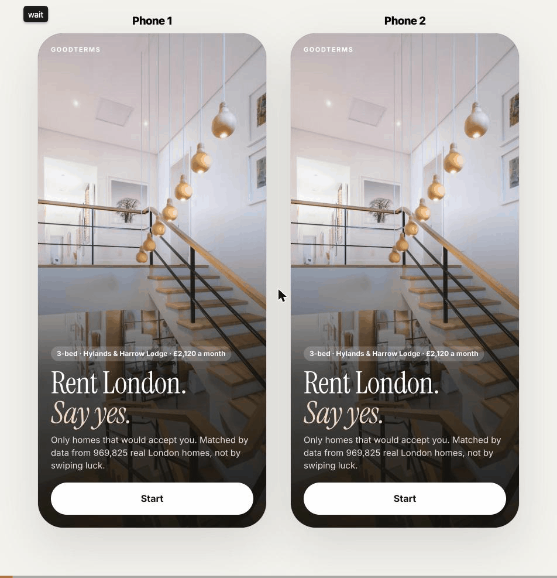

# GoodTerms

**London renting without the agency.** Renters say what they need once. Landlords set their rules once. Renters only see homes that would accept them. Landlords only hear from people who already qualify. A match goes straight to a viewing.

Built in one day at House London #3, 7 November 2026, Newspeak House.

## Why this matters
Today a London rental gets about 8 enquiries. Each one is a form, a wait for an agent, and a referencing check that costs £50 to £150. Most die on income or referencing after everyone's time is spent, and the home sits empty for about 19 days. GoodTerms flips the order: check first, match second. Fewer dead viewings, fewer empty weeks, fewer renters in limbo.

## Watch it


## Try it in two minutes
```sh
./run.sh
```
Then open http://localhost:8765 on your laptop, or http://YOUR-LAPTOP-IP:8765 on a phone on the same Wi-Fi.
Two phones side by side on one screen: http://localhost:8765/demo.html

## The demo, step by step
1. **Phone 1, the landlord.** Tap "I have a home to let". Postcode, bedrooms, rent (the app tells you if it is fair for that street), when it is free, your rules. Add a photo and a sentence. Publish.
2. **Phone 2, the renter.** Tap "I'm looking for a home". Same area, same bedrooms, a budget that covers the rent. Income and checks. Short profile. "Show my homes".
3. Watch the scan count down through real numbers to the homes that would say yes. The landlord's home is first.
4. Renter taps "Request a viewing". It appears on the landlord's phone with verified ticks, not documents. Landlord taps "Offer a viewing". It lands in the renter's chat.
5. Renter makes an offer, referencing runs from their vault, they sign by typing their name, keys.

See DEMO.md for the three-minute script.

## What is real and what is not
- **Real:** the 5,997 homes (sampled from 969,825 real London dwellings, Land Registry sales linked to EPC certificates by UCL), their sizes, energy ratings, build eras, and every neighbourhood number (Census 2021, Indices of Deprivation 2025, TfL PTAL, Foundations planning data, ONS rents).
- **Real:** the price model. 751-tree LightGBM trained on 1,177,400 London sales 2010 to 2022, tested on 40,282 sales from 2024 it never saw: median error 10.6%, against 21.6% for a borough-average method. Rent is the model's value times a borough yield set so each borough matches the ONS Price Index of Private Rents.
- **Modelled:** rents on the sample homes, landlord rules on the sample homes, and the "for rent" status itself. No open dataset of London rental listings exists.
- **Simulated for the demo:** identity, income and credit verification, deposit and gas checks (format checks today, provider checks in production), photos on sample homes.
- **Yours:** anything a landlord lists during the session is real: their photos, their words, their rules.

## How matching works
Area, rent, size, move-in date, distance to work, then the landlord's rules, in that order. Only homes that pass every step are shown. Five requests a day. A match closes in 24 hours unless a viewing is booked. Five active at most. An offer releases the rest. No photos of people on either side.

## Data sources
Foundations (foreman.house-london.uk, House London), the House London Data Asset Register, UCL House Price per Square Metre (London Datastore), ONS Price Index of Private Rents, Census 2021 via Nomis, English Indices of Deprivation 2025, TfL PTAL, Local Housing Allowance 2026-27, postcodes.io. WhereToBuild (CAGE Warwick, Kulka & Datta) was used at the event under its data-use agreement and is not included in this repository.

## Layout
- `backend/` FastAPI: matching (`scoring.py`), live two-sided layer (`live.py`), valuation (`valuation.py`)
- `frontend/` one HTML file, no build step; `demo.html` shows two phones
- `scripts/` data pipeline: fetch homes, build listings, enrich, train the price model
- `data/processed/` the listings table and the trained model (raw inputs are not committed; the scripts fetch them)

## Deploy for a week or a year
`render.yaml` and `Dockerfile` are included. Connect this repo to Render (free tier) and it builds itself. Or run `./run.sh` on any machine and put a tunnel in front of it.

## Team
Ahmed Elamin, Hassan. Built with Claude Code. House London #3.
